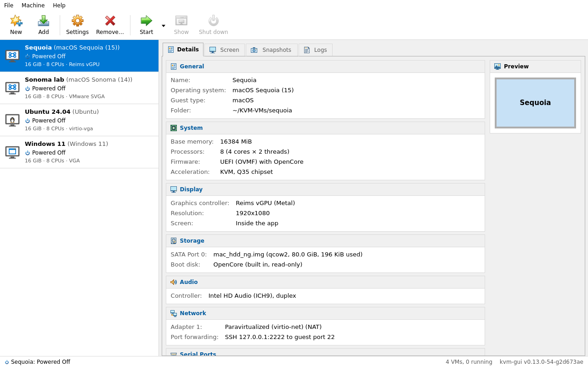
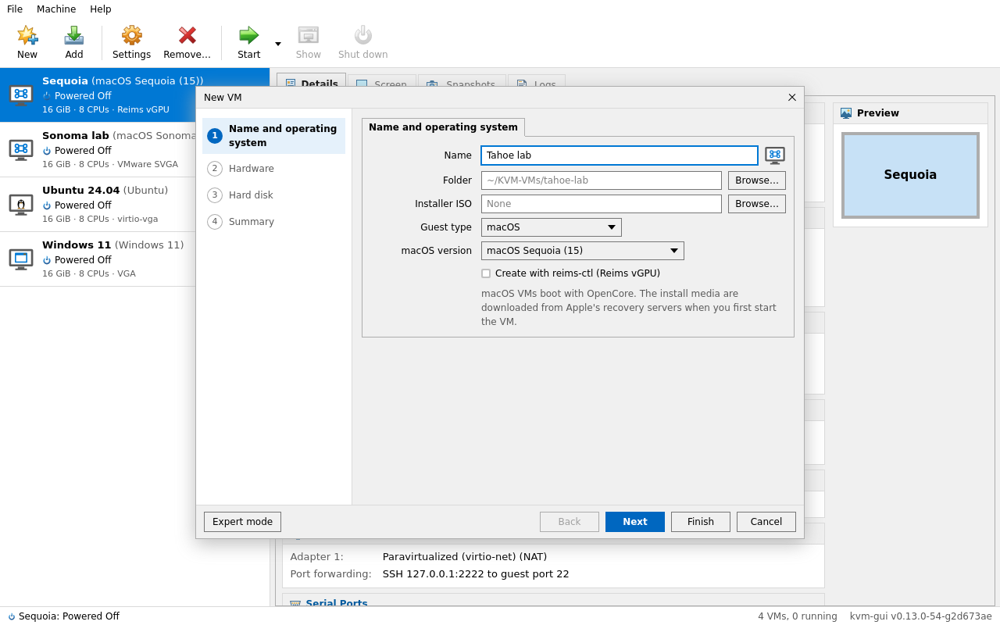
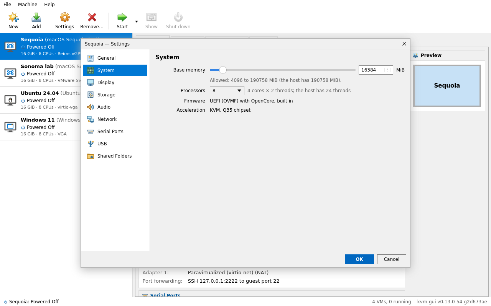
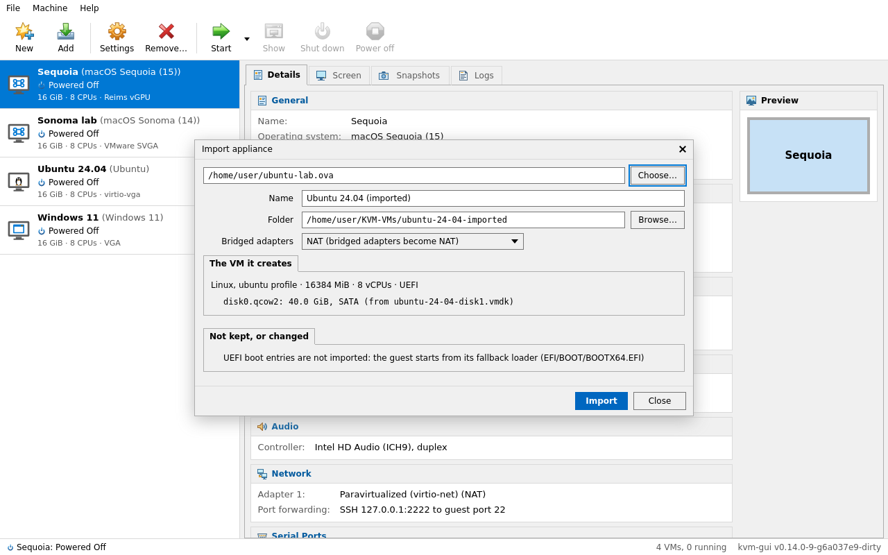
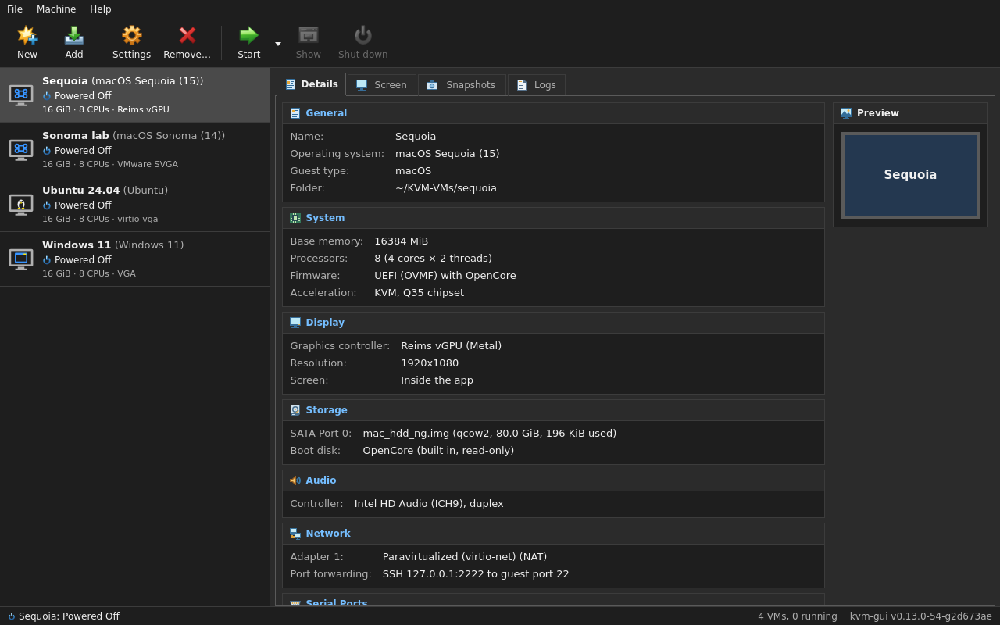

<p align="center">
  
</p>

<h1 align="center">kvm-gui</h1>

<p align="center">
  <b>A VirtualBox-like app for KVM on Linux: macOS, Linux and Windows VMs at native speed.</b><br>
  One binary with the GUI, a command line and an MCP server for AI agents. Nothing else to clone or configure.
</p>

<p align="center">
  <a href="https://github.com/jniltinho/kvm-gui/releases/latest"></a>
  <a href="https://github.com/jniltinho/kvm-gui/actions/workflows/ci.yml"></a>
  <a href="LICENSE"></a>
</p>



> **For home lab use.** macOS is Apple's software, and its license only allows it on Apple-branded hardware. Make sure your use complies with Apple's macOS license terms. This project is not affiliated with Apple.

## Why kvm-gui

- **macOS in a few clicks.** Pick a version and kvm-gui downloads the recovery from Apple. OpenCore and OVMF are built in, so there is no OSX-KVM clone or config.plist to edit.
- **Metal on macOS** with [Reims vGPU](https://github.com/steelbrain/reims-vgpu), a paravirtual GPU that runs on the host's Vulkan driver. You don't need a second graphics card.
- **Linux, Windows and other OSes** from an ISO: OS profiles, UEFI with Secure Boot, TPM 2.0 for Windows 11, screen sizes from HD to 4K.
- **3D and Vulkan in Linux guests** on the host GPU you pick, with no passthrough: OpenGL through virgl, Vulkan through Venus (`vulkaninfo` in the guest shows your AMD or NVIDIA card).
- **The VirtualBox workflow you know:** a Manager with Details, Screen, Snapshots and Logs; a New VM wizard; Settings; snapshots; full clones; **.ova import and export to and from VirtualBox**.
- **Native KVM speed**, and VMs keep running after you close the app.
- **Scriptable:** everything the GUI does is a [command](docs/cli.md), and AI agents (Claude, Cursor, Codex) can drive your VMs through the [MCP server](docs/mcp.md).

## Install

Download the package for your distribution from the [latest release](https://github.com/jniltinho/kvm-gui/releases/latest), then:

```sh
sha256sum -c --ignore-missing SHA256SUMS        # check the download
sudo apt install ./kvm-gui_*_amd64.deb          # Ubuntu 26.04, Debian 13
```

On Rocky Linux 10 (WebKitGTK comes from EPEL):

```sh
sudo dnf install epel-release && sudo dnf install ./kvm-gui-*-1.x86_64.rpm
```

There is also an AppImage and a plain binary; they need GTK 4, WebKitGTK 6 and QEMU from your distribution ([details](docs/getting-started.md#install-a-release)).

**You need** an x86_64 CPU with virtualization (VT-x / AMD-V) turned on in the firmware, and QEMU 10.0 or newer. The packages install QEMU for you. On Ubuntu 24.04, use [v0.15.0](https://github.com/jniltinho/kvm-gui/releases/tag/v0.15.0), the last release for it.

## Your first VM

```sh
kvm-gui setup      # once: loads KVM, adds you to the kvm group, installs anything missing
kvm-gui            # opens the app
```

Click **New**, then:

1. Choose **macOS** and its version, or **Linux / Windows / Other** with an ISO. kvm-gui detects the OS and fills in CPU, memory and disk for your host.
2. Click **Start**. The screen shows up inside the app. A macOS VM boots its Recovery (*macOS Base System*) by itself: install macOS from there.

The same steps from a terminal:

```sh
kvm-gui vm create Ubuntu --guest linux --profile ubuntu --iso ubuntu-26.04.iso
kvm-gui vm start
```

Moving from VirtualBox? Use **File › Import Appliance…** with a VirtualBox `.ova`, or `kvm-gui vm import-ova box.ova`.

More in [Getting started](docs/getting-started.md) and [Linux, Windows and Other guests](docs/guests.md).

## Use it with AI agents

```sh
claude mcp add kvm-gui -- kvm-gui mcp
```

Then ask, for example, *"create an Ubuntu VM from ~/Downloads/ubuntu.iso and start it"*. An agent can create, start and stop VMs, see the screen and type into it, run commands over SSH, take snapshots, and import and export appliances. Destructive actions need an explicit confirmation. See [MCP server](docs/mcp.md).

## Screenshots

| | |
|---|---|
|  |  |
|  |  |

More in [docs/screenshots](docs/screenshots/README.md).

## Supported hosts

| Host | Package | Status |
|---|---|---|
| Ubuntu 26.04 | `.deb` | tested on every CI run; the reference host (3D and Vulkan validated) |
| Debian 13 | `.deb` | tested on every CI run; 3D without Vulkan (its virglrenderer has no render server) |
| Rocky Linux 10 | `.rpm` | tested on every CI run; macOS VMs need Reims vGPU there, and its QEMU has no 3D |
| Ubuntu 24.04 | — | no longer supported: [v0.15.0](https://github.com/jniltinho/kvm-gui/releases/tag/v0.15.0) is the last release for it |

macOS guests: Sonoma is validated end to end, and Sequoia runs on Reims vGPU on the reference host. The other versions, High Sierra through Tahoe, are experimental.

<details>
<summary><b>Upgrading from <code>macos-kvm-gui</code></b></summary>

The packages replace `macos-kvm-gui` and keep `macos-kvm-gui` as a command name. The first start copies the old settings and VM list from `~/.config/macos-kvm-gui` to `~/.config/kvm-gui` and `~/.local/share/kvm-gui`, and leaves the old folder untouched; VMs stay in their folders. To be safe, back it up first:

```sh
tar czf ~/macos-kvm-gui-backup.tgz -C ~/.config macos-kvm-gui
```

To roll back, reinstall the old package (`sudo apt install ./macos-kvm-gui_0.13.0_amd64.deb`). It reads its own untouched folder, so VMs created or changed after the upgrade are not in its list.
</details>

## Documentation

[Getting started](docs/getting-started.md) · [Guests](docs/guests.md) · [Command line](docs/cli.md) · [MCP server](docs/mcp.md) · [Reims vGPU](docs/reims-vgpu.md) · [GPU passthrough](docs/gpu-passthrough.md) · [Troubleshooting](docs/troubleshooting.md) · [Architecture](docs/architecture.md)

## Contributing

Everything builds in one Docker image, so the host needs only Docker and make: `make image test dist`. See [Development](docs/development.md). Features are planned as [OpenSpec](openspec/) changes. The archived Rust app (`reims-gui`) is in [`archive/`](archive/rust/reims-gui/ARCHIVED.md).

## License

BSD-3-Clause ([LICENSE](LICENSE)). The embedded boot files keep their own licenses, and Reims vGPU's separately published packages theirs ([THIRD_PARTY_NOTICES.md](THIRD_PARTY_NOTICES.md)). Built on the work of [OSX-KVM](https://github.com/kholia/OSX-KVM), [acidanthera](https://github.com/acidanthera), [TianoCore](https://github.com/tianocore/edk2), [Dortania](https://dortania.github.io/) and [steelbrain/reims-vgpu](https://github.com/steelbrain/reims-vgpu); see [references](docs/references.md).
