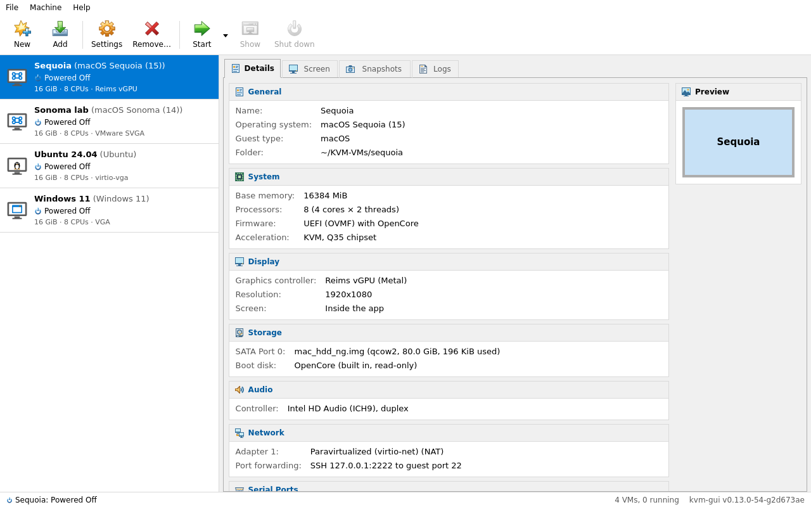
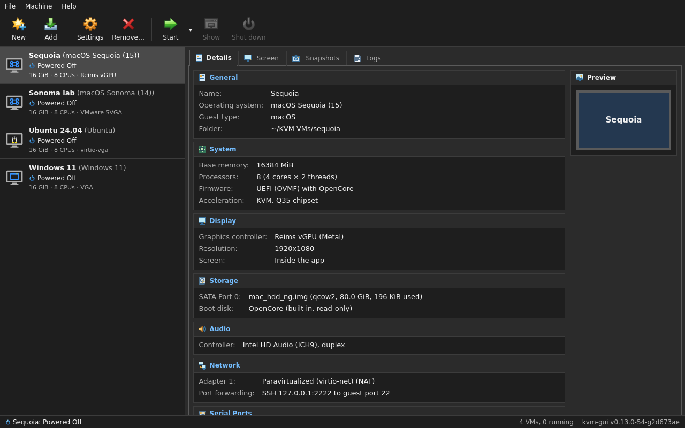
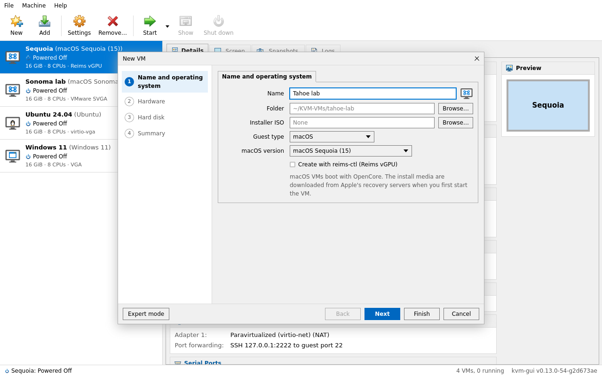
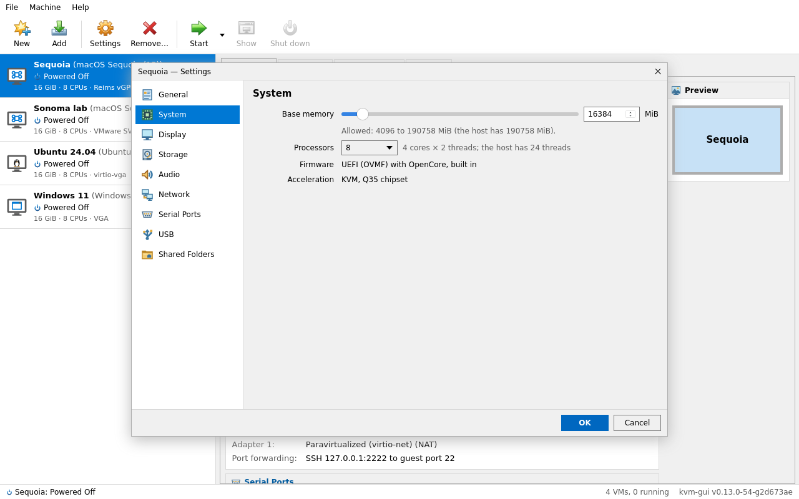
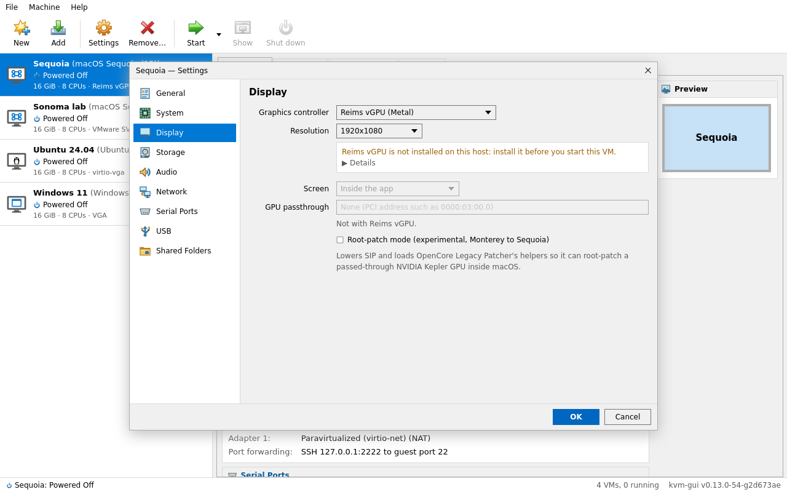
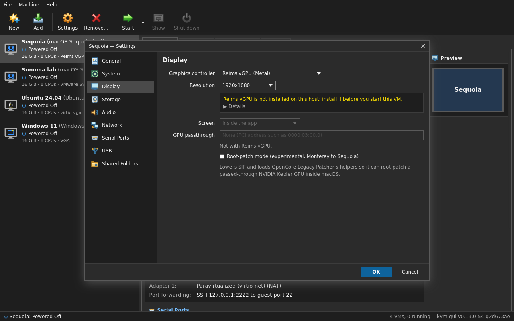
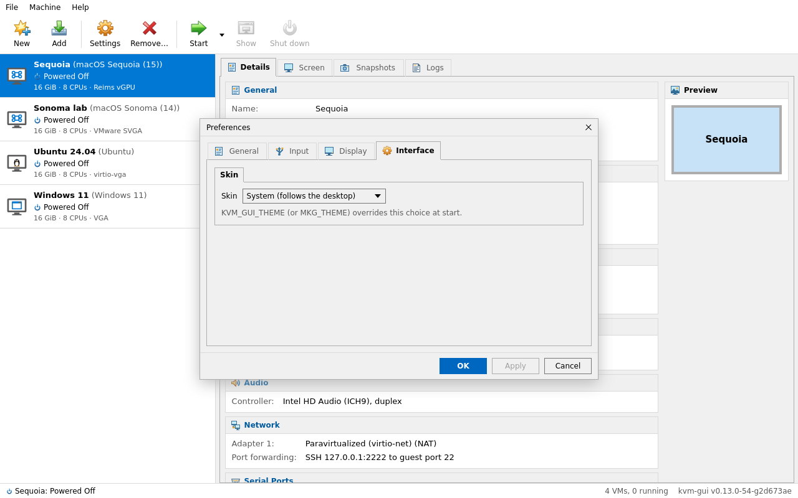
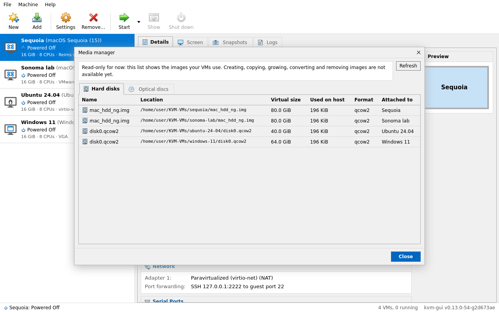

# Screenshots

Screens of kvm-gui, the Go + Wails desktop GUI, first, then of `reims-gui`, the archived Rust app, for history. Back to the [documentation](../README.md).

The kvm-gui screens were captured from the app itself (built from `main` right before v0.14.0) in the build image, under Xvfb with openbox at 1280x800, with four example VMs in an empty home folder; the host details (memory, threads) are the reference host's (Ryzen 9 9900X).

## kvm-gui



The Manager, modelled on VirtualBox's: the File / Machine / Help menus, the toolbar (New, Add | Settings, Remove | Start with its options, Show, Shut down), the VM list with each VM's guest, state, memory, CPUs and graphics, and the Details, Screen, Snapshots and Logs tabs. Details shows General, System, Display, Storage, Audio, Network and Serial Ports, with the Preview beside them. Here a Sequoia VM on Reims vGPU, whose screen is shown inside the app (the Screen tab) when started.





The New VM wizard, guided (Name and operating system, Hardware, Hard disk, Summary) or in expert mode: macOS with its version, or Linux, Windows and Other with an installer ISO and an OS profile; macOS VMs can also be created through upstream's `reims-ctl`.



A VM's Settings: General, System, Display, Storage, Audio, Network, Serial Ports, USB and Shared Folders. System sets the memory (within what the host has) and the processors (macOS needs a power-of-two core count).



Display with **Reims vGPU (Metal)** as the graphics controller: the resolution, whether Reims vGPU is installed on this host, and the screen inside the app. GPU passthrough is not available with Reims vGPU.





File › Preferences: the Workspace (where new VMs get their folder), input, display (the interface scale) and the skin: System, Light, Dark and three more; `KVM_GUI_THEME` overrides it at start.



File › Media manager: the hard disks and optical discs the VMs use, with their size on disk and the VM each is attached to.

### Updating these screenshots

Run the app in the build image, never on your own desktop session: Xvfb, openbox, a throwaway home (a tmpfs, so no personal path or VM shows) and VMs made with the command line, then `import -window <id>` of the app's window (`xdotool search --name kvm-gui`). `KVM_GUI_THEME=dark` for the dark ones. For example:

```sh
docker run -d --name shots --init --security-opt seccomp=unconfined --security-opt apparmor=unconfined \
  --security-opt systempaths=unconfined --user "$(id -u):$(id -g)" -v /etc/passwd:/etc/passwd:ro \
  --tmpfs /home/user:uid="$(id -u)",gid="$(id -g)" -e HOME=/home/user -v "$PWD:/src:ro" kvm-gui-build:24.04 \
  sh -c 'K=$(ls /src/dist/kvm-gui-v*-linux-amd64); $K vm create Sequoia --version sequoia; $K config set graphics=reims-vgpu;
         Xvfb :57 -screen 0 1600x1000x24 & sleep 1; DISPLAY=:57 openbox & sleep 1; DISPLAY=:57 dbus-run-session $K'
docker exec shots sh -c 'export DISPLAY=:57; import -window "$(xdotool search --name "^kvm-gui$" | head -1)" /tmp/manager.png'
```

## reims-gui (Rust, archived)


`reims-gui`, the Rust app and the recommended one: a Sequoia VM on Reims vGPU drawn by the RTX 4070 inside the Screen tab (the login was typed there). See [reims-gui](../reims-gui.md). Captured with reims-gui 0.1.4 on Ubuntu 24.04 (KDE Plasma, X11).


The same VM at the login screen: click the guest to type, Ctrl+Alt+Super releases the keyboard.


Details with the same sections as the Go app; the VM list shows memory, CPUs and the graphics adapter.


Settings › Display: Graphics Controller, Resolution and the one-time `METAL_ERROR_MODE` commands.


While a dialog covers the Screen tab, the embedded guest is hidden, so clicks never reach macOS.


The Install tab's steps, as in the Go app.


The GPU tab on a host with an RTX 4070 and an RX 6700 XT: neither is eligible for passthrough (no macOS driver; the 6700 XT needs a patch kext listed in settings.yaml).


The Log tab: QEMU's command line and output, here Reims vGPU's metal2vulkan notes.
